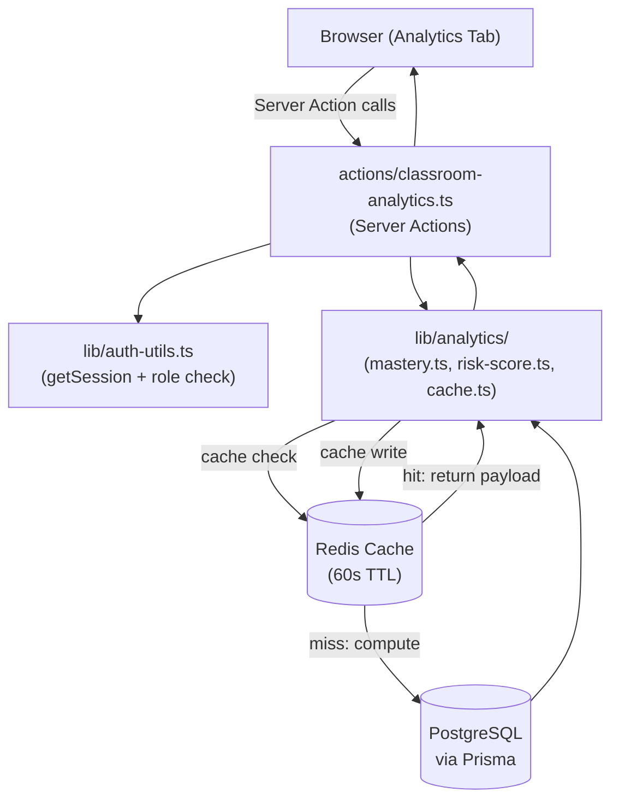
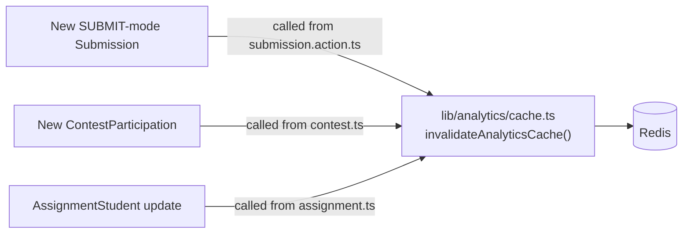

# Design Document: Teacher Classroom Analytics Dashboard

## Overview

The Teacher Classroom Analytics Dashboard is a new tab added to the existing classroom detail page at `/dashboard/classrooms/[id]`. It gives teachers a data-driven view of student performance — broken down by problem tags, difficulty levels, assignments, and contests — so they can identify struggling students and focus instruction effectively.

The feature is built entirely on top of existing data (`Submission`, `UserProblemSolved`, `ContestParticipation`, `Assignment`), adds one new Prisma model (`AssignmentStudent`), and introduces a new server action file (`actions/classroom-analytics.ts`) backed by pure computation utilities in `lib/analytics/`. All analytics payloads are cached in the existing Redis instance with 60-second TTLs.

### Key Design Decisions

- **No new API routes.** All data flows through Next.js server actions, consistent with the rest of the codebase (`actions/` pattern).
- **Pure utility functions** in `lib/analytics/` own all formula logic (mastery, risk score). This keeps server actions thin and makes the formulas independently testable.
- **Redis cache with DB fallback.** Every analytics function checks the Redis cache first and writes back on miss. On any Redis failure, computation falls back directly to the database.
- **Lazy loading of the analytics tab.** The analytics components use `next/dynamic` to avoid adding bundle weight to the classroom page until the tab is activated.
- **Risk scores are never persisted.** They are computed on every request using cached intermediates where possible.

---

## Architecture



### Cache Invalidation Flow



---

## Components and Interfaces

### New Files

```
actions/
  classroom-analytics.ts         # All analytics server actions

lib/
  analytics/
    mastery.ts                   # Tag mastery formula computation
    risk-score.ts                # Risk score formula computation
    cache.ts                     # Redis cache helpers (get/set/invalidate)
    types.ts                     # Shared TypeScript types for analytics

components/
  classroom/
    analytics/
      AnalyticsDashboard.tsx     # Root analytics tab container (client, lazy-loaded)
      OverviewPanel.tsx          # Top summary strip
      TagMasterySection.tsx      # Tag mastery list with topic drill-down
      StudentHeatmap.tsx         # Student × Tag color grid
      DifficultyAnalysis.tsx     # Easy/Medium/Hard grouped bar chart
      RiskStudentsList.tsx       # At-risk students with factor labels
      AssignmentAnalytics.tsx    # Assignment completion + per-tag accuracy
      ContestAnalytics.tsx       # Contest participation + scores
      shared/
        SkeletonLoader.tsx       # Shared loading skeleton
        EmptyState.tsx           # Shared empty state component
```

### Modifications to Existing Files

| File | Change |
|------|--------|
| `prisma/schema.prisma` | Add `AssignmentStudent` model and `AssignmentStudentStatus` enum |
| `components/classroom/ClassroomDashboard.tsx` | Add `'analytics'` tab to `activeTab` union; lazy-load `AnalyticsDashboard` |
| `components/classroom/ClassroomSidebar.tsx` | Add "Analytics" item under Monitoring section (teacher-only) |
| `actions/submission.action.ts` | Call `invalidateAnalyticsCache(classroomId, ...)` after SUBMIT-mode submission |
| `actions/assignment.ts` | Call `invalidateAnalyticsCache` after AssignmentStudent mutations |
| `actions/contest.ts` | Call `invalidateAnalyticsCache` after ContestParticipation mutations |

### Server Action Interface (`actions/classroom-analytics.ts`)

```typescript
// All functions share the same auth guard pattern:
// 1. getSession() → reject if invalid
// 2. role check (TEACHER | ADMIN) → reject if unauthorized
// 3. institution check (teacher.institutionId === classroom.institutionId)
// 4. Redis cache check → return cached if hit
// 5. DB query → compute → cache set → return

export async function getOverviewAnalytics(classroomId: string): Promise<OverviewData | AnalyticsError>
export async function getTagMasteryAnalytics(classroomId: string): Promise<TagMasteryData | AnalyticsError>
export async function getHeatmapAnalytics(classroomId: string): Promise<HeatmapData | AnalyticsError>
export async function getDifficultyAnalytics(classroomId: string): Promise<DifficultyData | AnalyticsError>
export async function getRiskAnalytics(classroomId: string): Promise<RiskData | AnalyticsError>
export async function getAssignmentAnalytics(classroomId: string): Promise<AssignmentAnalyticsData | AnalyticsError>
export async function getAssignmentTagBreakdown(classroomId: string, assignmentId: string): Promise<AssignmentTagData | AnalyticsError>
export async function getContestAnalytics(classroomId: string): Promise<ContestAnalyticsData | AnalyticsError>
```

---

## Data Models

### New Prisma Model: AssignmentStudent

```prisma
model AssignmentStudent {
  id                String                  @id @default(cuid())
  assignmentId      String
  userId            String
  startedAt         DateTime?
  completedAt       DateTime?
  status            AssignmentStudentStatus @default(NOT_STARTED)
  problemsSolved    Int                     @default(0)
  problemsAttempted Int                     @default(0)
  createdAt         DateTime                @default(now())
  updatedAt         DateTime                @updatedAt
  assignment        Assignment              @relation(fields: [assignmentId], references: [id], onDelete: Cascade)
  user              User                    @relation(fields: [userId], references: [id], onDelete: Cascade)

  @@unique([assignmentId, userId])
  @@index([userId, assignmentId])
  @@index([assignmentId, status])
  @@map("assignment_student")
}

enum AssignmentStudentStatus {
  NOT_STARTED
  IN_PROGRESS
  COMPLETED
  OVERDUE
}
```

The `Assignment` model and `User` model also need the back-relation added:

```prisma
// In model Assignment:
students  AssignmentStudent[]

// In model User:
assignmentProgress  AssignmentStudent[]
```

### TypeScript Types (`lib/analytics/types.ts`)

```typescript
export type AnalyticsError =
  | { success: false; error: 'SESSION_INVALID' }
  | { success: false; error: 'UNAUTHORIZED' }
  | { success: false; error: 'CLASSROOM_NOT_FOUND' }
  | { success: false; error: 'INTERNAL_ERROR' };

export interface OverviewData {
  success: true;
  studentCount: number;
  totalProblemsSolved: number;
  overallAccuracy: number;        // 0–100, 1 decimal
  averageMasteryScore: number;    // 0–100
  atRiskCount: number;
}

export interface TagMasteryItem {
  tagId: string;
  tagName: string;
  averageMastery: number;         // classroom average, 0–100
  label: 'Struggling' | 'Developing' | 'Proficient';
  topicTags?: TopicTagMasteryItem[];  // populated on drill-down
}

export interface TopicTagMasteryItem {
  tagId: string;
  tagName: string;
  averageMastery: number;
}

export interface TagMasteryData {
  success: true;
  tags: TagMasteryItem[];         // sorted ascending by averageMastery
}

export interface HeatmapCell {
  studentId: string;
  tagId: string;
  score: number;                  // 0–100
  attempts: number;
  accepted: number;
  color: 'red' | 'amber' | 'green' | 'gray';
}

export interface HeatmapData {
  success: true;
  students: { id: string; name: string }[];    // sorted by name asc
  tags: { id: string; name: string }[];        // sorted by mastery asc
  cells: HeatmapCell[];
}

export interface DifficultyTagItem {
  tagId: string;
  tagName: string;
  easy: number | null;            // null = no problems of that difficulty
  medium: number | null;
  hard: number | null;
}

export interface DifficultyData {
  success: true;
  items: DifficultyTagItem[];
}

export interface RiskFactor {
  label: string;                  // e.g., "14 days inactive"
  contribution: number;           // raw contribution to Risk_Score
}

export interface AtRiskStudent {
  studentId: string;
  name: string;
  image: string | null;
  riskScore: number;              // 0–100
  topFactors: RiskFactor[];       // top 3 by contribution
}

export interface RiskData {
  success: true;
  atRiskStudents: AtRiskStudent[];  // sorted by riskScore desc
  allClear: boolean;
}

export interface AssignmentStatus {
  assignmentId: string;
  title: string;
  dueDate: string | null;
  totalStudents: number;
  completed: number;
  inProgress: number;
  notStarted: number;
  overdue: number;
  completionPercentage: number;
}

export interface AssignmentAnalyticsData {
  success: true;
  assignments: AssignmentStatus[];
}

export interface AssignmentTagData {
  success: true;
  tagAccuracy: { tagName: string; accuracy: number }[];
}

export interface ContestStudentRow {
  studentId: string;
  name: string;
  image: string | null;
  participated: boolean;
  score: number;
  rank: number | null;            // null if did not participate
  practiceAccuracy: number;       // 0–100
  contestAvgScore: number;
}

export interface ContestItem {
  contestId: string;
  title: string;
  startTime: string;
  endTime: string;
  totalParticipants: number;
  averageScore: number;
  students: ContestStudentRow[];
}

export interface ContestAnalyticsData {
  success: true;
  contests: ContestItem[];
}
```

---

## Tag Mastery Formula (`lib/analytics/mastery.ts`)

The `computeTagMastery(submissions, tagProblems, recentCutoff)` function accepts pre-fetched submission data and returns a score in [0, 100].

```
Tag_Mastery_Score = (
  correctness    × 0.40  +   // ACCEPTED / total SUBMIT-mode × 100
  difficulty     × 0.20  +   // weighted accuracy: EASY=1×, MEDIUM=2×, HARD=3×
  recency        × 0.20  +   // correctness rate in last 30 days (0 if no recent subs)
  repeatPenalty  × 0.10  +   // 100 − penalty for avg attempts before ACCEPTED
  coverage       × 0.10      // distinct problems attempted / total problems × 100
)
```

All components are computed in [0, 100] before weighting. The repeat-attempts penalty is: `Math.min(100, (avgAttemptsBeforeAccepted - 1) * 20)` so each extra attempt costs 20 points, capped at 100 (component cannot go below 0). A student with zero attempts for a tag gets score = 0 by early-exit before any formula computation.

The function signature:

```typescript
export interface TagSubmissionData {
  problemId: string;
  difficulty: 'EASY' | 'MEDIUM' | 'HARD' | 'CONCEPT';
  status: 'ACCEPTED' | string;
  createdAt: Date;
}

export function computeTagMastery(
  submissions: TagSubmissionData[],   // SUBMIT-mode submissions for problems in this tag, for this student
  totalProblemsInTag: number,         // denominator for coverage
  recentCutoffDays?: number           // default 30
): number  // [0, 100]
```

### Risk Score Formula (`lib/analytics/risk-score.ts`)

```
Risk_Score = (
  lowMastery         × 0.30   // (100 − avg_mastery_across_tags) × 0.30
  lowRecentAccuracy  × 0.20   // (100 − accuracy_last_14_days) × 0.20; if no subs → 20
  inactivity         × 0.15   // min(days_since_last_submit / 14, 1) × 15
  repeatedFailures   × 0.15   // proportion of problems with ≥3 fails and no ACCEPTED × 0.15 × 100
  assignmentIncomplete × 0.10 // proportion of NOT_STARTED|OVERDUE assignments × 0.10 × 100
  decliningPerformance × 0.10 // 10 if accuracy_last_7d < accuracy_prev_7d - 20, else 0
)
```

The function signature:

```typescript
export interface RiskInput {
  averageMastery: number;          // pre-computed, 0–100
  recentSubmissions14d: { status: string }[];
  daysSinceLastSubmit: number;
  problemsWithRepeatedFailures: number;
  totalProblems: number;
  incompleteAssignments: number;
  totalAssignments: number;
  accuracy7dLast: number;
  accuracy7dPrev: number;
}

export interface RiskBreakdown {
  score: number;                   // [0, 100]
  factors: { name: string; contribution: number; label: string }[];
}

export function computeRiskScore(input: RiskInput): RiskBreakdown
```

---

## Redis Cache Layer (`lib/analytics/cache.ts`)

### Cache Key Schema

```
classroom:{classroomId}:analytics:overview
classroom:{classroomId}:analytics:tag-mastery
classroom:{classroomId}:analytics:heatmap
classroom:{classroomId}:analytics:risk
classroom:{classroomId}:analytics:assignments
classroom:{classroomId}:analytics:contests
```

TTL: **60 seconds** for all keys.

### `getAnalyticsCache` / `setAnalyticsCache`

Thin wrappers around the existing `cachedFetch` pattern in `lib/cache-utils.ts` with the analytics key prefix and 60-second TTL.

```typescript
export function analyticsKey(classroomId: string, section: AnalyticsSection): string
export async function getAnalyticsCache<T>(key: string): Promise<T | null>
export async function setAnalyticsCache<T>(key: string, data: T): Promise<void>

export type AnalyticsSection =
  | 'overview' | 'tag-mastery' | 'heatmap' | 'risk'
  | 'assignments' | 'contests';
```

### `invalidateAnalyticsCache`

Called from mutation paths (submission, contest, assignment) to atomically attempt invalidation of all relevant keys. Individual failures are caught and logged; remaining keys continue to be deleted.

```typescript
/**
 * @param classroomId - the classroom whose cache to invalidate
 * @param sections - which sections to invalidate; defaults to all
 */
export async function invalidateAnalyticsCache(
  classroomId: string,
  sections?: AnalyticsSection[]
): Promise<void>
```

The function uses `Promise.allSettled` to ensure all keys are attempted even if some fail, satisfying the atomic-invalidation-on-best-effort requirement.

---

## Data Flow

Each analytics server action follows this linear flow:

```
1. getSession()                          → reject with SESSION_INVALID if null
2. role check (TEACHER | ADMIN)          → reject with UNAUTHORIZED if wrong role
3. prisma.classroom.findUnique(...)      → reject with CLASSROOM_NOT_FOUND if missing
4. institution check                     → reject with UNAUTHORIZED if cross-institution
5. analyticsKey(classroomId, section)   → build Redis key
6. getAnalyticsCache(key)               → return immediately if hit
7. prisma query(ies)                    → fetch raw data
8. compute*(data)                       → run pure formula functions
9. setAnalyticsCache(key, result)       → write back (non-blocking, fire-and-forget)
10. return result
```

Redis errors at step 6 or 9 are caught silently; the action proceeds to step 7 on any cache error.

### DB Queries per Section

**Overview (`getOverviewAnalytics`)**:
```sql
-- 1. Student count
SELECT count(*) FROM "user" u JOIN "_StudentClassrooms" sc ON u.id = sc."B" WHERE sc."A" = {classroomId}

-- 2. Submissions aggregate (problems solved + total submits + accepted)
SELECT
  count(DISTINCT up.problem_id) as solved,
  count(s.id) as total_submits,
  sum(CASE WHEN s.status = 'ACCEPTED' THEN 1 ELSE 0 END) as accepted
FROM submission s
JOIN "user" u ON s.user_id = u.id
JOIN "_StudentClassrooms" sc ON u.id = sc."B"
WHERE sc."A" = {classroomId} AND s.mode = 'SUBMIT'
```
Risk count is computed by running `computeRiskScore` for each student and counting those ≥60. To avoid full computation for overview, the overview action fetches a lightweight risk proxy (days_since_last, recent accuracy, mastery) rather than the full 6-factor breakdown.

**Tag Mastery (`getTagMasteryAnalytics`)**:
1. Fetch all tags on problems in classroom assignments and contests.
2. For each tag, fetch all SUBMIT-mode submissions by classroom students for problems with that tag (including `status`, `difficulty`, `createdAt`, `problemId`).
3. For each student × tag pair, run `computeTagMastery`.
4. Average per tag across students.

**Heatmap (`getHeatmapAnalytics`)**:
Same data as tag mastery but pivoted into a cell matrix rather than aggregated averages. Can reuse tag mastery intermediates if computed in the same request (share via closure or compute both from the same DB fetch).

**Risk (`getRiskAnalytics`)**:
Fetches per-student: average mastery (from tag mastery computation), last 14d submissions, last 28d submissions (for 7d windows), days since last submit, problem attempt counts, assignment status counts. Runs `computeRiskScore` for each student.

**Assignment Analytics (`getAssignmentAnalytics`)**:
Fetches all assignments for the classroom with associated `AssignmentStudent` records. For students with no record, treats as NOT_STARTED.

**Contest Analytics (`getContestAnalytics`)**:
Fetches all contests where `classroomId = id`. For each contest, fetches all classroom-student submissions within contest time bounds grouped by userId to compute scores. Fetches `ContestParticipation` records for participation status.

---

## UI Components

### `AnalyticsDashboard.tsx`

The root client component mounted lazily. Uses React's `useState` to track which sub-section is expanded. Calls each server action independently on mount (or on tab activation) so sections can load in parallel and render as they arrive.

```typescript
// Loaded as: dynamic(() => import('./analytics/AnalyticsDashboard'), { ssr: false })
export function AnalyticsDashboard({ classroomId }: { classroomId: string }) {
  // Fetches overview, tag mastery, heatmap, difficulty, risk, assignments, contests
  // each via separate useEffect/SWR calls so partial loads are visible
}
```

### `OverviewPanel.tsx`

Four stat cards in a responsive grid: Total Students, Problems Solved, Overall Accuracy, Avg Tag Mastery, At-Risk Count. Uses shadcn/ui `Card` components.

### `TagMasterySection.tsx`

Sorted list of tag cards, each showing name, average mastery percentage, color-coded label (Struggling / Developing / Proficient), and a horizontal progress bar. Click to expand shows TopicTag mastery sub-list. Uses Recharts `RadialBar` or shadcn `Progress` for the bar.

### `StudentHeatmap.tsx`

CSS Grid with sticky first column (student names) and sticky header row (tag names). Cells are colored divs with inline `title` attribute for touch/hover tooltips. For >30 students, the container sets `overflow-x: auto`. Tag columns and student rows are virtualized with a simple slice if the grid exceeds 50 × 30 cells.

### `DifficultyAnalysis.tsx`

Recharts `BarChart` with grouped bars (Easy/Medium/Hard) per tag. Falls back to a shadcn `Table` if chart data is empty or an error occurs.

### `RiskStudentsList.tsx`

Sorted list of at-risk student cards. Each card shows avatar, name, risk score badge, and up to 3 factor pills (e.g., "14 days inactive", "Low Arrays mastery (32%)"). Uses shadcn `Badge` for factor pills. Shows "All students are performing well 🎉" when `allClear = true`.

### `AssignmentAnalytics.tsx`

Accordion of assignment rows. Collapsed: title, due date, progress bar, status counts. Expanded: calls `getAssignmentTagBreakdown(classroomId, assignmentId)` on first expansion, shows per-tag accuracy table.

### `ContestAnalytics.tsx`

Accordion of contest rows. Collapsed: title, dates, participant count, average score. Expanded: sortable table of students with participated status, score, rank, and contest-vs-practice comparison columns.

### Page Integration

```tsx
// In ClassroomDashboard.tsx — add 'analytics' to the tab union:
const [activeTab, setActiveTab] = useState<
  'leaderboard' | 'tracking' | 'assignments' | 'performance' | 'analytics'
>('leaderboard');

// Add lazy import:
const AnalyticsDashboard = dynamic(
  () => import('./analytics/AnalyticsDashboard').then(m => m.AnalyticsDashboard),
  { loading: () => <SkeletonLoader />, ssr: false }
);

// Add tab render:
{activeTab === 'analytics' && (
  <motion.div key="analytics" /* same motion props */ className="w-full h-full overflow-y-auto">
    <AnalyticsDashboard classroomId={classroom.id} />
  </motion.div>
)}
```

```tsx
// In ClassroomSidebar.tsx — add under the Monitoring section (isTeacher only):
{ id: 'analytics', label: 'Analytics', icon: LdChart, description: 'Deep analytics on tag mastery, risk scores, assignments, and contests.' }
```

---

## Correctness Properties

*A property is a characteristic or behavior that should hold true across all valid executions of a system — essentially, a formal statement about what the system should do. Properties serve as the bridge between human-readable specifications and machine-verifiable correctness guarantees.*

### Property 1: Tag Mastery Score Bounds and Weights

*For any* set of SUBMIT-mode submissions for a student on a given tag (including empty sets), the computed `Tag_Mastery_Score` shall be in the range [0, 100], and for a non-empty submission set with at least one ACCEPTED submission the score shall be strictly greater than 0.

**Validates: Requirements 3.2, 3.3**

### Property 2: Tag Mastery Sort Order

*For any* classroom's computed tag mastery list, the list shall be sorted in ascending order by `averageMastery` score — i.e., `tags[i].averageMastery ≤ tags[i+1].averageMastery` for all i.

**Validates: Requirements 3.5, 4.1**

### Property 3: Heatmap Cell Color Correctness

*For any* `(score, attempts)` pair, the cell color function shall return: `gray` when `attempts === 0`, `red` when `attempts > 0 && score < 40`, `amber` when `score >= 40 && score < 70`, and `green` when `score >= 70`.

**Validates: Requirements 4.2, 4.4**

### Property 4: Risk Score Bounds and Monotonicity

*For any* valid `RiskInput`, `computeRiskScore` shall return a score in [0, 100], and the `factors` array shall contain exactly 6 entries whose `contribution` values sum to the returned score (within floating-point tolerance of 0.01).

**Validates: Requirements 6.1, 6.5**

### Property 5: At-Risk Filter and Sort

*For any* list of computed risk scores, the filtered-and-sorted output shall contain only students with `riskScore >= 60` and shall be in strictly non-increasing order of `riskScore`.

**Validates: Requirements 6.2**

### Property 6: Assignment Status Counts Consistency

*For any* assignment in any classroom, the sum `completed + inProgress + notStarted + overdue` shall equal `totalStudents` — the number of enrolled students.

**Validates: Requirements 7.1, 7.2**

### Property 7: Authorization Gate — Role Invariant

*For any* requesting user whose role is not `TEACHER` or `ADMIN`, every analytics server action shall return an error payload with `success: false` and an authorization-related error code rather than student data.

**Validates: Requirements 2.4, 10.2**

### Property 8: Cross-Institution Isolation

*For any* teacher whose `institutionId` differs from the requested classroom's `institutionId`, every analytics server action shall return an authorization error rather than classroom data.

**Validates: Requirements 10.4**

### Property 9: No Submission Code in Analytics Responses

*For any* analytics payload returned by any server action, no field at any depth of the response object shall be a string value equal to a raw submission code string (i.e., no `code` field from the `Submission` model shall appear in any analytics response type).

**Validates: Requirements 10.3**

### Property 10: Contest Rank Sort Correctness

*For any* list of contest participant rows, the `rank` values shall be assigned such that the student with the highest `score` receives rank 1, and ties shall be broken by the earliest last-ACCEPTED-submission time (earlier time = lower rank number).

**Validates: Requirements 8.5**

### Property 11: Missing AssignmentStudent Defaults to NOT_STARTED

*For any* student enrolled in a classroom and any assignment in that classroom for which no `AssignmentStudent` record exists, the assignment analytics query shall report that student's status as `NOT_STARTED` and their count shall appear in the `notStarted` bucket.

**Validates: Requirements 1.4, 7.2**

---

## Error Handling

All server actions return a discriminated union type: `SuccessPayload | AnalyticsError`. The error variants are:

| Error Code | Condition | HTTP Analogue |
|---|---|---|
| `SESSION_INVALID` | No valid session cookie | 401 |
| `UNAUTHORIZED` | Valid session but wrong role or cross-institution | 403 |
| `CLASSROOM_NOT_FOUND` | classroomId does not exist | 404 |
| `INTERNAL_ERROR` | Unexpected DB or computation error | 500 |

**Redis errors** are caught at the `getAnalyticsCache` and `setAnalyticsCache` call sites. On any error, the cache miss path proceeds normally. The error is logged via `console.error("[Analytics Cache]", ...)` but never propagated to the client.

**Empty classrooms** (zero students) are handled by the formulas: all computations receive empty arrays and return 0 / null / "N/A" appropriately. No special-casing is required in server actions beyond the formula implementations.

**Partial data states** (students enrolled but no submissions) are valid inputs to all formula functions. Formulas treat empty submission arrays as zero-attempt cases.

---

## Testing Strategy

### Unit Tests (formula functions)

Focus on the pure utility functions in `lib/analytics/`. These have no I/O and are ideal for example-based and property-based tests.

```
lib/analytics/__tests__/
  mastery.test.ts         # Property tests for Tag Mastery Score
  risk-score.test.ts      # Property tests for Risk Score
  cache.test.ts           # Unit tests for key generation helpers
```

Use **fast-check** (TypeScript property-based testing library) for property tests. Each property test runs 100+ iterations.

Tag each property test with a comment:
```typescript
// Feature: teacher-classroom-analytics, Property 1: Tag Mastery Score Bounds and Weights
```

**Property test examples:**

```typescript
// Property 1: mastery score is always in [0,100]
fc.assert(fc.property(
  fc.array(submissionArb),        // arbitrary submission arrays
  fc.integer({ min: 1, max: 20 }),// totalProblemsInTag
  (submissions, total) => {
    const score = computeTagMastery(submissions, total);
    return score >= 0 && score <= 100;
  }
), { numRuns: 200 });

// Property 4: risk score factors sum to total score
fc.assert(fc.property(riskInputArb, (input) => {
  const { score, factors } = computeRiskScore(input);
  const sum = factors.reduce((acc, f) => acc + f.contribution, 0);
  return score >= 0 && score <= 100 && Math.abs(sum - score) < 0.01;
}), { numRuns: 200 });
```

### Integration Tests (server actions with mocked DB)

Focus on the authorization and caching behavior of server actions. Use **vitest** with Prisma mock (`jest-mock-extended` or `@vitest/mock`).

```
actions/__tests__/
  classroom-analytics.test.ts
```

Test cases:
- Null session → `SESSION_INVALID` error
- Non-teacher role (every role except TEACHER/ADMIN) → `UNAUTHORIZED`
- Cross-institution teacher → `UNAUTHORIZED`
- Cache hit → returns cached data without calling prisma
- Cache miss → calls prisma, sets cache, returns data
- Redis error → falls back to DB query, returns data normally

### Example-Based Unit Tests

```
components/classroom/analytics/__tests__/
  OverviewPanel.test.tsx       # Renders zero states correctly
  StudentHeatmap.test.tsx      # Color mapping for example inputs
  RiskStudentsList.test.tsx    # allClear message when no at-risk students
```

### Property Tests in Components

The `getHeatmapCellColor(score, attempts)` function and `getTopFactors(breakdown)` function should each have property tests verifying Properties 3 and 5 respectively.
